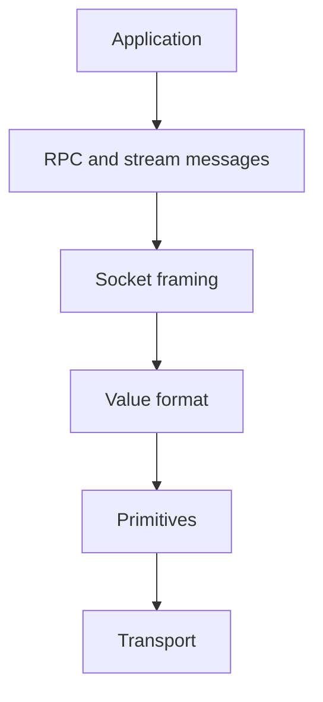

# 1. Architecture

The protocol is a stack. Each layer consumes the layer below it and
does not interpret the layer above it.

Source: [layers.mmd](../diagrams/layers.mmd).

## Transport

The transport MUST deliver an ordered, lossless byte stream. It MAY be
a memory buffer, a circular buffer, TCP, a WebSocket, `postMessage`,
or a WebAssembly heap. This specification does not define how bytes
are carried.

A transport MUST NOT reorder, drop, or duplicate socket messages.
Message boundaries are recovered from the length prefix in
[socket framing](05-socket-framing.md), not from the transport.

## One format per socket

A socket MUST use exactly one value format for the bodies of its
socket messages. Flat, compressed, and key encodings are not
byte-compatible. A receiver MUST treat a body encoded in a different
format as a malformed message.

The type-registry blob is the exception: its body is always compressed,
and an envelope byte names the data format. See
[type registry blob](04-type-registry-blob.md).

## Roles

- A **client** sends `rpc_request` and `stream_cancel`.
- A **server** sends `rpc_response`, `rpc_error`, and the server-to-client
  stream messages.

Either peer MAY be the producer of a stream. The direction of each
assigned message is fixed in the [registry](12-registry.md).
