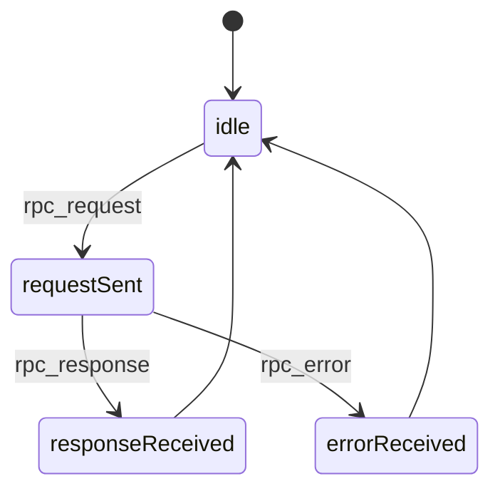
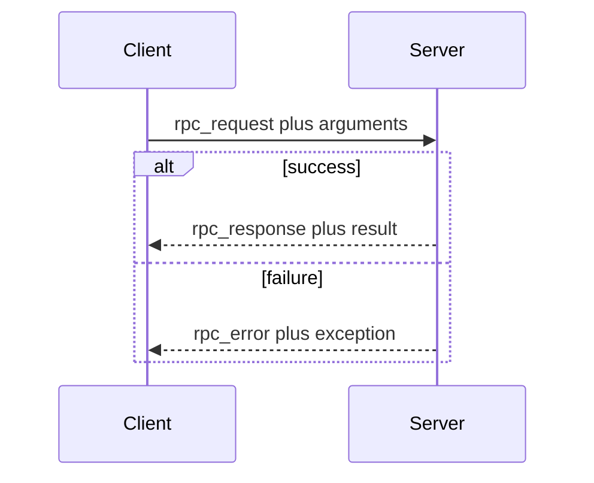

# 6. RPC messages

Indices are assigned in [the registry](12-registry.md). On the flat
socket these integers are `u64` little-endian. On the compressed socket
they are uvarint64.

## `rpc_request` (index 0)

Direction: client to server.

| Field | Type |
|-------|------|
| `request_id` | `u64` |
| `function_id` | `u64` |

The trailing payload is the argument list, in declaration order, in
the socket's value format. `request_id` is chosen by the client.
A client MUST NOT reuse a `request_id` that still has an outstanding
call on that socket.

## `rpc_response` (index 1)

Direction: server to client.

| Field | Type |
|-------|------|
| `request_id` | `u64` |

The trailing payload is the result. A void result has an empty
trailing payload. There is no success flag byte. A receiver MUST NOT
expect a legacy success byte in front of the payload.

## `rpc_error` (index 2)

Direction: server to client.

| Field | Type |
|-------|------|
| `request_id` | `u64` |

The trailing payload is one serialized exception: a type index, then
the exception value. If the exception type is not in the registry, the
payload is the unknown-exception type, whose body is one string.

A server MUST send either `rpc_response` or `rpc_error` for each
accepted `rpc_request`, and MUST NOT send both. A server MUST copy
`request_id` from the request.

## Call state machine

One call is one `request_id`. The machine is per call, not per socket.

Source: [rpc-call-state.mmd](../diagrams/rpc-call-state.mmd).

A call in `requestSent` MUST ignore a response or error whose
`request_id` does not match. After `responseReceived` or
`errorReceived` the id is free.

## Sequence

Source: [rpc-call-sequence.mmd](../diagrams/rpc-call-sequence.mmd).

Unknown `function_id` is an error, not a dropped request. The server
MUST answer with `rpc_error`.
