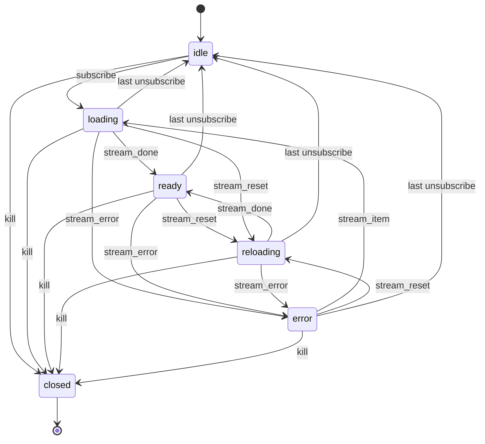

# 8. Observable state machine

An observation of one stream is always in exactly one state. The
machine is the receiver's. The sender only emits the messages in
[stream messages](07-stream-messages.md).

Source: [observable-state.mmd](../diagrams/observable-state.mmd).

## States

| State | Meaning |
|-------|---------|
| `idle` | No consumers. Upstream is stopped (`stream_cancel` has been sent). The view MAY be retained. Not terminal. |
| `loading` | At least one consumer. Initial scan or delta resume is in progress. |
| `ready` | Catch-up finished (`stream_done`). Further `stream_item` messages are live updates. `ready` does not mean the stream is silent. |
| `reloading` | A `stream_reset` arrived. The previous view is retained for reads. A new view is built from the following items. |
| `error` | A `stream_error` arrived. The view is retained. Recoverable. |
| `closed` | Explicit kill or destruction. Terminal. |

Last unsubscribe MUST enter `idle`, not `closed`. Re-subscribe from
`idle` MUST request `since_timestamp` equal to the highest timestamp
seen, or `0` if none was seen.

## Transitions a receiver MUST implement

- `idle` to `loading` on subscribe.
- `loading` to `ready` on `stream_done`.
- `ready` or `loading` to `reloading` on `stream_reset`.
- any non-terminal state to `error` on `stream_error`.
- `error` to `loading` on a later `stream_item` (delta resume).
- `error` to `reloading` on `stream_reset`.
- `reloading` to `ready` on `stream_done`, after the new view replaces
  the old one. The receiver MUST NOT invent tombstones for keys missing
  from the rescan; absence after a clear is the delete.
- `loading`, `ready`, `reloading`, or `error` to `idle` on the last
  unsubscribe. The receiver MUST send `stream_cancel`. On the way out
  of `error`, the error state is dropped; the receiver MAY keep the
  last error text for diagnostics.
- any state to `closed` only on explicit kill. Kill unsubscribes every
  consumer first.

During `reloading`, reads MUST be served from the previous view.
`stream_item` messages during `reloading` fill the new view only.

## Backpressure

A receiver MAY stop reading when a consumer is not ready for the next
item. A sender that cannot queue a `stream_item` MUST NOT skip it and
MUST NOT send `stream_done` or `stream_error` ahead of that item.
`stream_reset` drops the blocked item and is sent next.
